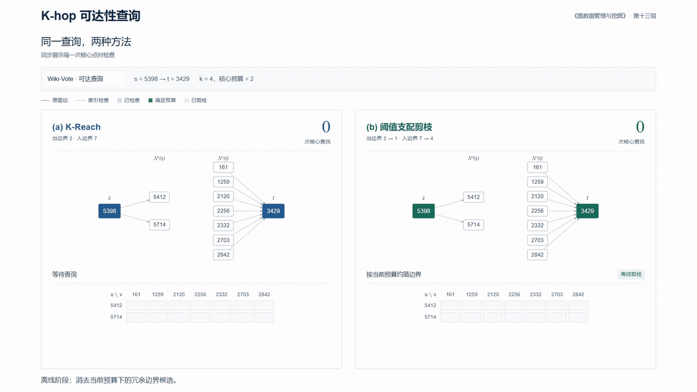

# 第十三组 · K-hop 可达性查询

《图数据管理与挖掘》课程期中汇报。

本项目研究有向图上的 K-hop 可达性查询，阅读并实现 K-Reach（PVLDB 2012），提出**预算相关的边界支配剪枝**，在保持精确判定的同时减少候选枚举。

## 汇报与演示

- **[第十三组-期中汇报.pdf](docs/第十三组-期中汇报.pdf)**：13 页主讲，约 10 分钟；其后 14 页问答备份，主讲到结论页停止。
- **[网页演示](visualization/index.html)**：主展示入口，支持连续动效、逐步检查和全屏投影；另有论文原理、阈值剪枝和实验结果。
- **[备用视频](visualization/方法对比.mp4)**：1080p、60 fps，包含可达、不可达及无支配关系三种真实查询。
- **[逐页讲稿与答辩](docs/十分钟讲稿与答辩.md)**、[论文精读](docs/paper_review/K-Reach精读.md)、[方法说明](docs/方法说明.md)、[实验报告](docs/实验报告.md)。
- **源码**：[report.tex](docs/slides/report.tex) 是主入口，[paper.tex](docs/slides/paper.tex) 介绍背景与论文，[improvement.tex](docs/slides/improvement.tex) 介绍改进与实验，[qa.tex](docs/slides/qa.tex) 是附录。

[](visualization/index.html)

采用公开的 [sonnyhcl/beamerthemefdu](https://github.com/sonnyhcl/beamerthemefdu) 复旦主题，使用原生封面、正文导航、标题栏、校徽水印和页脚。源主题及许可保存在 docs/slides/vendor-fdu/，配置见 [模板与排版说明](docs/模板与排版说明.md)。

## 改进解决什么

覆盖外端点可能接入多个核心邻居。若某个邻居在当前预算内能贡献的全部核心目标，已被另一个邻居覆盖，就可提前消去。难点是**预算和方向都不能混用**：Case 2/3 用 k−1，Case 4 用 k−2；出边界比较后继集，入边界比较前驱集。

课程反例仅在原论文图上加 c→d：同一边界 {b,d}，预算 1 应留 b，预算 2 却应留 d。统一选代表或直接用 SCC 等价会丢失合法答案。主报告第 8–9 页完整解释，第 11–12 页给出机制和时间结果。

主实验固定 k=4 时，Wiki 上在**相同 Hybrid 编码**之上获得约 1.28× 额外加速，在 CSR 求交基线上约 1.13×。额外边界约 70 KiB，构建约 0.10s；预处理开销约在 192 万次查询后摊平。P2P 和 Email 的查询时间变化较小。改进保持判定结果不变，约简后的候选组合上界不增加；实际减少的查找次数取决于预算内的支配关系。

主实验 27 万查询条次、八种方案共 216 万次判定全部对照完整 BFS 真值；另有覆盖种子、独立整数距离支配证书、小图穷举、跨语言对照及受控合成图。详细成本、限制和原始数据均保留。

## 关键目录

| 路径 | 内容 |
|---|---|
| [code/](code/) | 算法、实验、正确性验证；构建工具放在 code/scripts/ |
| [docs/](docs/) | 汇报 PDF、论文笔记、方法与实验报告；Beamer 源码在 docs/slides/，课程要求在 docs/course/ |
| [data/](data/) | 原始图 raw/、预处理图 processed/、实验结果 results/ |
| [visualization/](visualization/) | 交互页面、动画、视频、图数据及跨语言对照 |

本地历史版本归入 data/archive/；预览、编译缓存和论文下载缓存不提交到 Git。

## 复现

环境：Conda agent / Python 3.11.15，依赖见 code/requirements.txt；Node，XeLaTeX / TeX Live 2024，Arial 和微软雅黑。浏览器检查及视频帧使用 Playwright 与本机 Edge，视频编码使用 FFmpeg。其他机器的绝对时间会变化，精确性和数组字节应一致。

在项目根目录执行 PowerShell：

```powershell
# 使用现有实验数据，重做算法与证书检查、图表、报告、PDF 和浏览器检查
powershell -ExecutionPolicy Bypass -File code/scripts/rebuild.ps1

# 完整重跑编码、剪枝主实验、覆盖补充与合成图
powershell -ExecutionPolicy Bypass -File code/scripts/rebuild.ps1 -RerunExperiments

# 仅重新编译 PDF
python code/scripts/build_slides.py

# 仅更新交互演示与方法对比视频
python code/build_kreach_demo.py
python code/scripts/render_comparison_video.py

# 真实图 k=4 检查点：SNAP 原始 ID；不传点对则使用交付查询的首条
python code/query.py --dataset wiki-Vote
python code/query.py --dataset wiki-Vote --method ranked
```

可用 `-Python 'C:\path\to\python.exe'` 更换解释器；没有浏览器环境时可显式 `-SkipBrowserCheck`，复用随交付保存的浏览器证据。重新下载公开输入用 `python code/scripts/acquire.py --proxy http://127.0.0.1:7897`。构建脚本默认复用保存的计时，只有 -RerunExperiments 才重新测量。

主讲论文：[K-Reach, 2012](https://doi.org/10.14778/2350229.2350247)。相关研究：[VCRea, 2023](https://doi.org/10.3390/app13063470)、[CSUR, 在线 2025 / 卷期 2026](https://doi.org/10.1145/3776737)。原文实验、本机实验、合成压力测试分别标明。论文链接、阅读笔记和下载脚本均在项目目录中。

